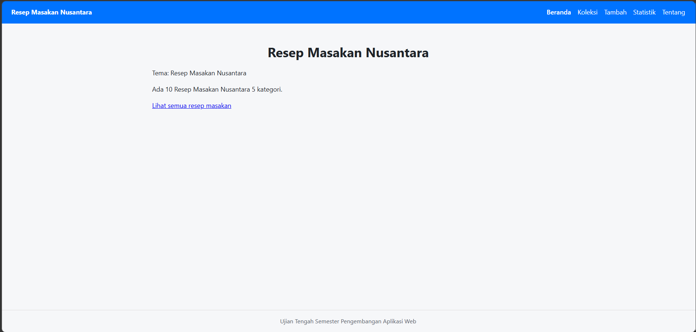
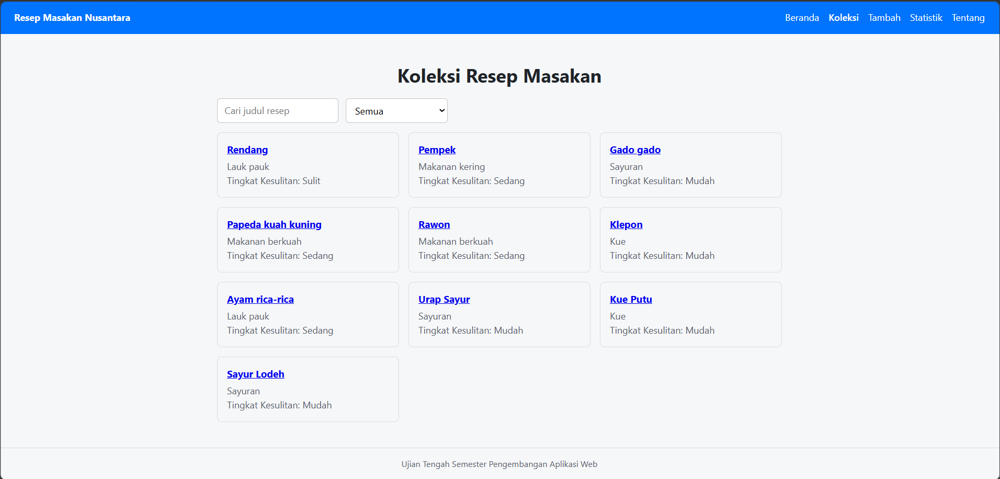
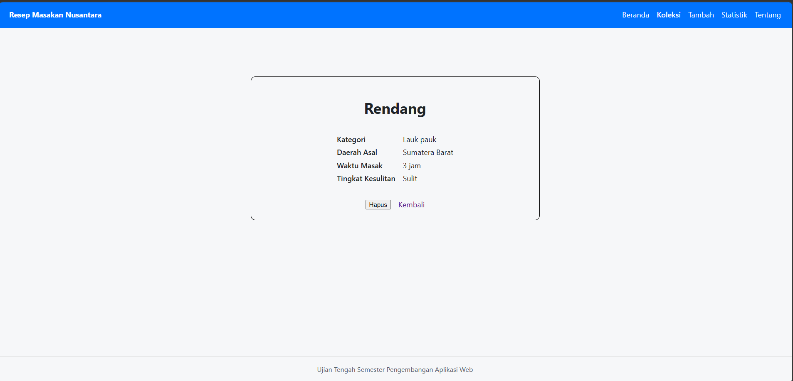
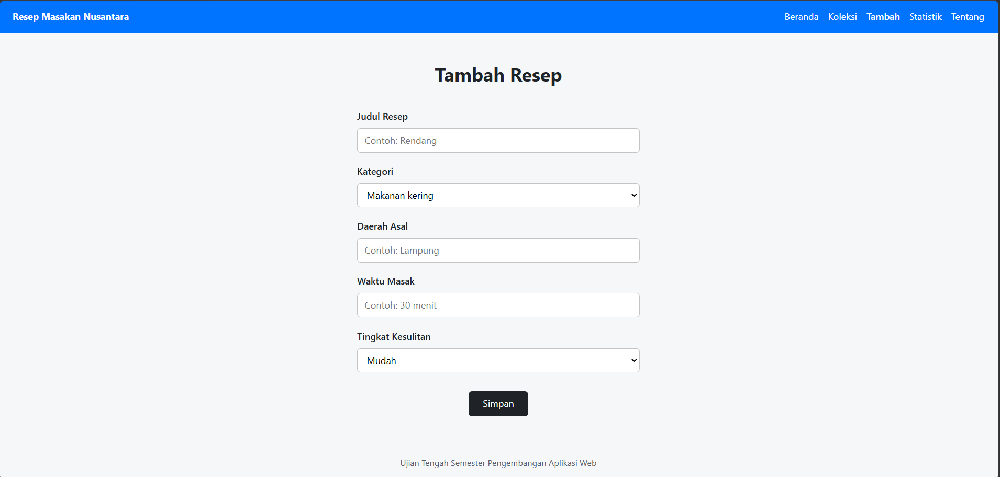
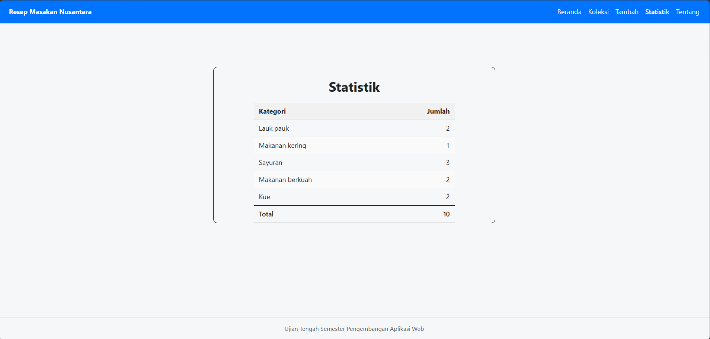
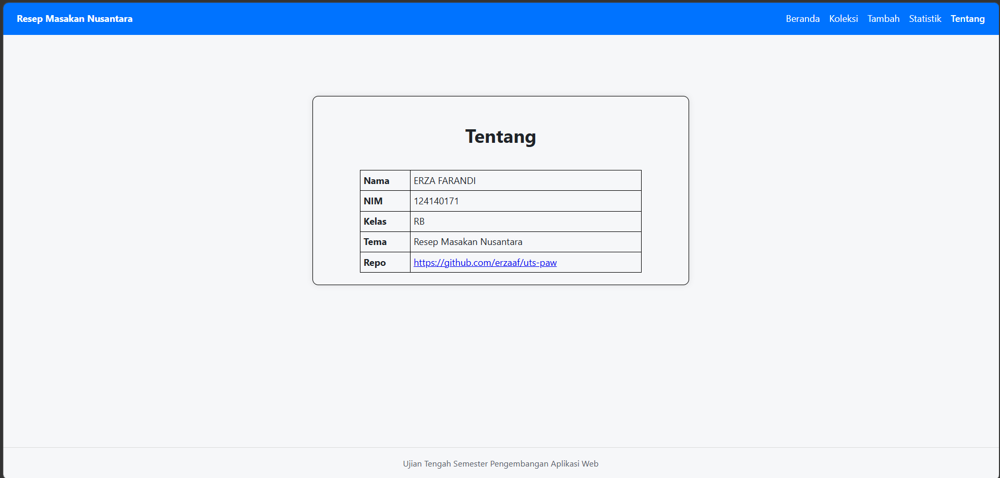

# Aplikasi Web Resep Masakan Nusantara

- Nama: ERZA FARANDI
- NIM: 124140171
- Kelas: RB
- Tema: Resep Masakan Nusantara
- Deployment: https://erzaaf.github.io/uts-paw/

## Tangkapan Layar Aplikasi

| Halaman Beranda | Halaman Koleksi |
| :---: | :---: |
|  |  |
| *Gambar 1. Halaman Beranda* | *Gambar 2. Halaman Koleksi Resep* |

| Halaman Detail Resep | Halaman Tambah Resep |
| :---: | :---: |
|  |  |
| *Gambar 3. Halaman Detail Resep* | *Gambar 4. Halaman Form Tambah Resep* |

| Halaman Statistik | Halaman Tentang |
| :---: | :---: |
|  |  |
| *Gambar 5. Halaman Statistik Koleksi* | *Gambar 6. Halaman Tentang* |

## Fitur

- Halaman Beranda (Memuat ringkasan resep masakan)
- Halaman Koleksi (Memuat daftar resep masakan Nusantara, serta dapat mencari dan memfilter berdasarkan kategori)
- Halaman Tambah (Dapat menambah resep baru)
- Halaman Statistik (Menampilkan statistik resep masakan berdasarkan kategori)
- Halaman Tentang (Memuat identitas)

## Menjalankan secara lokal

   ```bash
   cd app
   npm install
   npm run dev
   ```

## Konsep React yang dipakai

- Components: KotakPencarian, KartuItem
- useState: Mengelola perubahan data pada komponen, seperti input pencarian, filter kategori, dan formulir tambah
- useEffect: Memuat data koleksi.json
